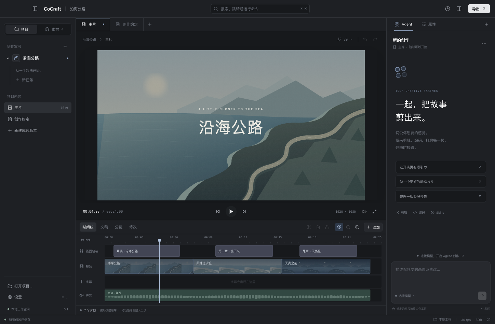

# CoCraft

一个可以真正剪辑、编程和导出的视频创作工作台。面向 macOS，使用 Electron、React、TypeScript、Pi 与 Remotion。当前为 **0.1 本地 Alpha**。

## 直接体验

打开 [CoCraft.app](release/mac-arm64/CoCraft.app)。首次启动会创建一份 24 秒的「沿海公路」示例工程，包含原创插画、动态标题和合成氛围音；不需要模型密钥即可编辑和导出。

- 选择时间线片段，在右侧「属性」修改文案、时间、构图和音量。
- `Space` 播放，`⌘B` 分割，`L` 锁定，`⌘Z` 撤销，`⌘K` 打开命令面板。
- 「素材」中导入视频、图片、音频；拖入时间线，或点击素材的 `＋`。
- 「添加」使用内置标题、字幕和背景，或直接编写 React / Remotion 画面。
- 在设置中连接模型后，Agent 可读写代码、调用剪辑工具、加载 Skills，并发布可撤销修改。
- 导出使用固定版本；可以继续编辑。后台作业中打开 MP4 或在 Finder 中查看。

[首版交付说明](docs/DELIVERY-0.1.md) · [功能验收](docs/verification/electron-functional.md) · [实际导出的 1080p 示例](artifacts/CoCraft-coast-demo-1080p.mp4)



## 源码运行

要求 Node.js 22.19+、npm、Apple Silicon Mac。当前包体目标为 macOS 15+。

```bash
npm install
npm run build
npm start
```

```bash
npm run dev          # 桌面开发；首次自动准备预览与合成 bundle
npm run smoke        # 工程编辑、锁定、冲突、撤销重做和重开
npm run smoke:agent  # 本地协议夹具驱动真实 Pi SDK，不调用付费模型
npm run test:ui      # 独立临时工程的 Electron 功能验收
npm run package     # 构建 Apple Silicon .app
```

开发模式下工作台支持 Vite 热更新；修改预览组件、桌面服务或渲染入口后重新构建/启动。打包后不需要 Node.js。媒体工具随包分发。导出优先使用本机 Chrome / Chromium；没有浏览器时，Remotion 会下载渲染浏览器到应用缓存。

如果 npm 被全局配置为忽略安装脚本，需要执行 `node node_modules/electron/install.js` 安装 Electron 运行时。项目未改变你的全局 npm 配置。

## 已实现的闭环

| 工作 | 当前实现 |
| --- | --- |
| 工程 | 多项目、独立成片、任务对话、创作约定、原子版本发布、撤销重做、版本恢复、关闭重开 |
| 剪辑 | 本机素材导入、拖放、移动、裁切、分割、复制、删除/波纹删除、锁定、画幅副本 |
| 预览 | 实际 Remotion Player、逐帧跳转、镜头导航、音量、播放中的版本固定 |
| 文字 | 标题/下三分之一/字幕，参数编辑，按帧动画，SRT 导入导出与文稿编辑 |
| 编码 | TSX 编辑与编译，参数化代码片段，标准 Skills，Pi 文件工具与可选受限脚本 |
| 素材 | 原创示例、内置动态组件、本地系统配音、Pexels 搜索与导入连接器 |
| 交付 | 后台 H.264/AAC MP4、PNG 静帧、进度/取消、固定导出版本、完成后打开 |

Pi 协议、真实工具执行和编译发布已通过本地夹具验证；**尚未使用你的模型密钥验收真实模型的剪辑质量**。Pexels 同样需要你自己的 API Key；没有配置时会明确提示。自动语音转录、语义删句联动剪辑、生成式图片/视频服务、跨项目素材库、OAuth 登录、HDR 和专业多机位流程属于后续迭代，不在本版已实现范围内。

## 代码结构

```text
src/
  core/             工程模型、编辑操作、校验与差异
  composition/      Player 与 MP4 共用的画面定义
  components/       时间线、属性、对话框及基础 UI
  App.tsx           工作台交互与状态协调
  preview.tsx       不含桌面权限的独立预览页
  styles.css        Graphite / Paper 工作台样式与动效

electron/
  main.ts           桌面生命周期、文件选择与窄 IPC
  store.ts          项目、不可变快照与发布指针
  agents.ts         Pi 生命周期、任务与发布授权
  agent-worker.ts   独立 Pi 进程、工具、Skill 与脚本执行
  jobs.ts           持久化作业与取消
  render-worker.ts  独立 Remotion 导出进程
  media.ts          媒体探测、缩略图、真实音频波形
  code.ts           TSX 组件构建适配器
  server.ts         有随机令牌的本机媒体/预览服务
  settings.ts       模型连接与加密密钥

resources/          原创示例、应用图标、内置 Skills
scripts/            构建、开发与必要 smoke / 功能验收
artifacts/          可观看的实际导出
release/            本机 .app 构建产物（不进 Git）
docs/               产品、架构、迭代与验收材料
design/             早期设计原型与截图，保留作对照
```

## 数据与运行边界

默认工程位于 `~/Library/Application Support/CoCraft/Projects`。在命令面板中「打开工程文件夹」即可访问。原始导入媒体保持不变；工程默认引用其原路径，因此移动原文件前请保留副本。Agent 新生成并登记的媒体会收集到工程素材目录。

密钥通过 Electron safeStorage 使用 macOS 系统能力加密，不写入工程。没有自动读取 Codex 的登录态。Agent 默认可在任务工作区编辑源码；脚本执行和脚本联网分别在设置中启用。脚本写入被限制在任务工作区，已发布工程通过受控发布入口修改。第三方任意扩展的完整安全兼容性仍需逐项验证。

这是供本机评估的未签名构建。公开分发前仍需签名、公证、更新渠道及 [第三方许可核对](docs/THIRD_PARTY.md)。

## 产品材料

[愿景](docs/VISION.md) · [PRD](docs/PRD.md) · [架构](docs/ARCHITECTURE.md) · [决策](docs/DECISIONS.md) · [迭代记录](docs/ROADMAP.md) · [素材与 Skills](docs/ASSETS_AND_SKILLS.md) · [官方参考](docs/REFERENCES.md) · [设计原型](design/README.md)
