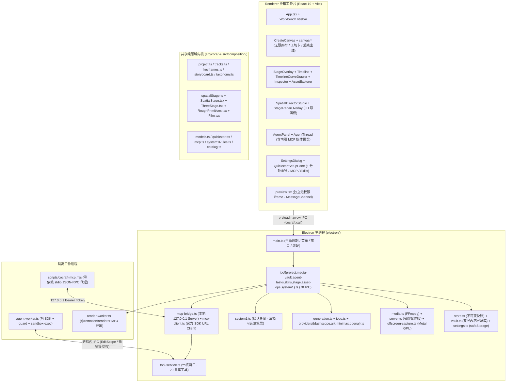

# CoCraft 技术架构（v0.6）

更新日期：2026 年 11 月 26 日。状态：v0.6.0 架构现状（覆盖 Wave A–D 稳定化与解债、统一空间摄影棚与 3D 导演棚、一核两口工具服务层、双向 MCP、Electron Metal GPU 离屏渲染引擎、多云直连驱动与自由多轨贝塞尔关键帧）。

---

## 一、核心架构原则

1. **单一确定性合成内核（Single Remotion + Three.js + RoughJS Kernel）**
   - 实时预览（`@remotion/player`）、Metal GPU 离屏拍帧/录片（`OffscreenCaptureService`）与正式 MP4 导出（`@remotion/renderer`）共享同一套 React 合成树（[src/composition/Film.tsx](../src/composition/Film.tsx)）：普通音视频、真 A/B 交叉叠化转场、L1 电影化叠层与逐词高亮字幕、RoughJS 确定性手绘、TSX 动态图形组件，以及统一空间摄影棚（2.5D 多层视差 / 3D 导演白模 / 硬件贴屏 / `.glb` 骨骼 / 原生 WebGL2 3DGS 高斯泼溅），全部由帧号确定性驱动。
2. **双模同源不可变快照（Single Source of Truth）**
   - 「创造画布」「专业剪辑」与「3D 导演棚」读写同一份不可变 `Project` 版本快照。人工编辑、内置 Pi Agent 与外部 MCP 的所有写入全部经 `ProjectStore.edit()` 校验基线版本、锁定状态、内容指纹、选区作用域（`EditScope`）与组件写时复制（Copy-on-Write），原子推进 `.cocraft/head.json` 指针与 O(1) `.cocraft/revisions-index.json`。
3. **「一核两口」人机与生态能力统一**
   - 内置 Pi Coding Agent 与对外 Opt-in 本地 MCP 服务端共享同一份 [electron/tool-service.ts](../electron/tool-service.ts)（20 项核心工具），确保两套入口零能力漂移；外部能力通过官方 `@modelcontextprotocol/sdk` 纯 URL 客户端（[electron/mcp-client.ts](../electron/mcp-client.ts)）与三层优先级标准 `SKILL.md` 无缝接入。
4. **纵深隔离与安全边界**
   - 渲染进程零 Node 权限，[electron/preload.ts](../electron/preload.ts) 仅暴露单通道窄接口 `cocraft:call`；主进程按领域拆分为 `electron/ipc/*` 7 个模块共 78 项受控方法；独立预览页走私有 `MessageChannel` + 动态严格 CSP；Agent 工作区经递归 `lstat/readlink` 堵死悬空软链逃逸，脚本执行受 macOS `sandbox-exec` `(deny default)` 约束；远程媒体下载执行 DNS 全 IP / IPv6 / 云元数据 SSRF 防护与 512MB 流式落盘。

---

## 二、总体分层与模块边界



---

## 三、核心子系统职责

### 1. 主进程模块化 IPC 层（`electron/main.ts` + `electron/ipc/`）
- [electron/main.ts](../electron/main.ts) 仅负责单实例锁、应用生命周期、服务装配、原生菜单与 `cocraft:call` 发送方校验。
- 全部 78 项主进程方法收拢在 `electron/ipc/index.ts` 的 `IPC_HANDLERS` 映射表，按业务边界拆分为 7 个模块：
  - `project.ts`：启动引导、工程切换/编辑/撤销/历史派生、设置保存、MCP 桥接与客户端控制、导出预检与作业调度；
  - `media-vault.ts`：本地素材导入、SHA-256 指纹锁保护重连、SRT 导入导出、TSX 编译、离线/个人素材包与全局 Vault；
  - `agent-tasks.ts`：会话管理、多模态粘贴/文件附件、Agent 启停、提供商连通探针与多模态生成任务；
  - `skills.ts`：`project → user → builtin` 三层优先级 Skill 发现、新建覆盖、删除与整目录包导入；
  - `stage.ts`：统一空间摄影棚与 3D 导演棚拍摄管线（`captureReference` / `bakeSpatialVideo` / `captureSpatialPair` / `captureMultiCamStoryboard` / `shootDirectorShots` / `componentPoster`）；
  - `asset-ops.ts`：本地 FFmpeg 确定性加工（抽首尾帧、提取 WAV 音轨、`-14 LUFS` 响度标准化、气口去静音）与视觉反推文本节点；
  - `system1.ts`：可选三档 System 1 状态/测试/用量、Omnibar 本地分流、9:16 Auto-Reframe、候选质检挑优与智能标角色。

### 2. 双模工作台与 3D 导演棚（`src/components/` & `src/styles/`）
- **高频性能解耦**：时间线播放头由外部订阅对象 [src/lib/playheadClock.ts](../src/lib/playheadClock.ts) 驱动 GPU `translate3d` 与局部 `<PlayheadTimecode>`，`rAF` 节流预览 `seek`，播放与搓擦期间零根树重绘；舞台通过 `[data-clip-box]` 像素测量与 `live-transform` 实现 60fps 跟手操控。
- **创造画布组件化（`src/components/canvas/`）**：节点卡与交互层已拆分为 `CanvasStarterGuide`（3 分钟首片起点 + 引擎状态条）、`CanvasVaultCard`、`CanvasAssetCard`、`CanvasComponentCard`、`CanvasShotCard`、`CanvasGeneratorNode`、`CanvasGhostCard`、`CanvasFramesLayer`、`CanvasContextMenu`、`CanvasTopHud`、`CanvasLeftToolbar`、`CanvasMultiBar`、`CanvasOmnibar`、`CanvasForkPopover`、`CanvasDropMenu`、`CanvasAnimaticModal`。
- **完整版「3D 导演棚」（[SpatialDirectorStudio.tsx](../src/components/SpatialDirectorStudio.tsx)）**：以「片场布景 → 镜头单（`still` 定机位 vs `motion` 运镜）→ 拍摄出素材与 `sceneSignature` 变更重拍」三层模型组织；通过 `DirectorContext` 零改码接管自定义 TSX 3D 组件的 60fps 鼠标运镜与 5 通道渲染，配合 `StageRadarOverlay` 2D 俯视调度图与 1:1 像素对齐标尺/内联贝塞尔曲线抽屉形成闭环。
- **模块化样式体系（`src/styles/`）**：[src/workbench.css](../src/workbench.css) 作为按严格层叠顺序加载的样式清单，引入 9 个分域样式文件（`foundation` / `ide-shell` / `canvas-core` / `inspector-nle` / `agent-chat` / `director-studio` / `settings-waves` / `canvas-v3-pro` / `quickstart`），辅以独立光学微光层 [src/optical-light.css](../src/optical-light.css)。

### 3. 渲染、离屏 Metal GPU 与多云生成管线
- **Electron Metal GPU 离屏引擎（[electron/offscreen-capture.ts](../electron/offscreen-capture.ts)）**：复用隐藏沙箱 `BrowserWindow` + Apple Silicon Metal 硬件加速，零外部 Chrome 唤起、零 Dock 跳图标，接管全部静帧抽帧、组件封面、编译验画、多通道参考拍帧、首尾双拍与 3D 预演 MP4 录片（单帧 ~0.35s）。
- **正式交付渲染（[electron/render-worker.ts](../electron/render-worker.ts)）**：独立进程运行 `@remotion/renderer`（macOS 启用 `gl: 'angle'`），绑定不可变快照与引用计数媒体服务，优先使用 `chrome-headless-shell`，支持取消与原子替换落盘。
- **插件式多提供商驱动（`electron/providers/`）**：`dashscope.ts`、`ark.ts`、`minimax.ts`、`openai.ts` 与通用作业持久化、崩溃续传、SSRF 防护解耦；前端由 `modelInputCapabilities()` 与 `QUICKSTART_PROFILES`（[src/core/quickstart.ts](../src/core/quickstart.ts)）统一驱动表单与 1 分钟一键配置。

### 4. Agent 沙箱、双向 MCP 与安全纵深
- **独立 Pi 进程与强边界（[electron/agents.ts](../electron/agents.ts) & [electron/agent-worker.ts](../electron/agent-worker.ts)）**：任务运行拥有独立工作副本与 `runId` 令牌；停止瞬间撤销提交资格并向子进程发送 `SIGTERM → 2s SIGKILL`；文件读写经递归软链 `guard()` 限制在授权根内；可选脚本执行通过 macOS `sandbox-exec` `(deny default)` 隔离用户隐私目录与本机回环。
- **双向 MCP**：
  - **对外服务（[electron/mcp-bridge.ts](../electron/mcp-bridge.ts) + [scripts/cocraft-mcp.mjs](../scripts/cocraft-mcp.mjs)）**：默认关闭，启用后仅监听 `127.0.0.1` 随机端口，32 字节随机 Bearer Token 以 `0600` 权限写入 `<userData>/mcp-bridge.json`，`timingSafeEqual` 鉴权，零密钥暴露。
  - **对内客户端（[electron/mcp-client.ts](../electron/mcp-client.ts)）**：基于官方 `@modelcontextprotocol/sdk`，仅连接用户配置中已运行的外部 MCP URL（`StreamableHTTPClientTransport` 优先，自动回退 `SSEClientTransport`），Headers 经 `safeStorage` 加密；工具返回的 `image` 与 `resource` 自动落盘 `.mcp-artifacts/` 并在对话内联呈现缩略图灯箱与视觉模型透传。

---

## 四、工程目录结构（Schema v2，兼容 v1）

```text
my-project.cocraft/
  project.json                  可读工程镜像（单源快照最新视图）
  brief.md                      创作目标、受众与风格约定
  assets/                       生成媒体、3D 预演录片、多通道抽帧、.glb/.spz 模型与随附资产
  components/                   独立 TSX 动态/3D 组件与导入素材包源码快照
  skills/                       项目级标准 SKILL.md（含附属 scripts/ 与 references/）
  exports/                      MP4 成片、PNG 静帧与 SRT 字幕导出
  .cocraft/
    head.json                   唯一原子发布指针（current / undo / redo）
    revisions-index.json        O(1) 轻量版本历史索引
    revisions/                  不可变工程快照序列
    analysis/                   音视频峰值波形、持久化时间戳转录缓存
    thumbnails/                 按内容哈希失效的精准抽帧缓存
    workspaces/                 各 Agent 任务隔离工作区与 .mcp-artifacts/
    sessions/                   Pi 会话历史与 Token 用量记录
```
