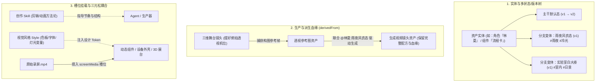

# CoCraft 产品需求规格书（PRD）

版本：v0.4（架构重塑定稿草案）　更新日期：2026 年 11 月 18 日

CoCraft 是一款面向 macOS 的 **「资产生产 + 分镜编排 + 可编程动画/3D 舞台 + 专业剪辑」一体化创作工作台**。创作者与编码 Agent 围绕同一份本地工程协作：既能把一句话想法、一段文稿或原始录屏/图片快速**生产**为结构化专属资产（固定角色/产品多状态形象、可改字动态图解、三维空间拆解镜头、精装特写录屏、配音与字幕），也能在导演级分镜台进行多候选（Takes）对比，并在支持直接交互的 2D/3D 舞台与像素级多轨时间线上精剪出片。

---

## 一、 核心产品哲学与设计铁律

1. **提供「生产资产的能力」，而非塞给用户无意义的预制假样片**
   - 首次打开或新建工程时，不塞写死无关故事的假样片或虚构人物卡；而是提供意图清晰的**创作起点向导**与即开即用的**资产生产工坊**，辅以纯粹、高频、无假故事文案的通用基础积木（风格变量、设备外壳、背景底板、三维灯光棚、点缀音效与方法论 Skill）。
2. **界面彻底清零内部技术黑话**
   - 用户界面只呈现符合创作者直觉的自然语言（如「动态逻辑图解」「手绘白板推演」「三维空间与拆解」「录屏特写包装」「固定角色形象」），严禁把 `SeeCode`、`Tinycharts`、`Anatomy`、`Teardown`、`ScreenFocusRig`、`Preset`、`Ground Truth` 等内部实现代号直接暴露给普通用户。
3. **三元彻底解耦：`创作 Skill` × `视觉风格（Style）` × `组件模板（Component）` 自由混搭**
   - **Skill（方法论）**只定义叙事节奏、剪辑规则与编码规范，不绑死特定配色或固定几块模板；
   - **视觉风格（Style）**独立管理色板、字体层级、描边圆角与三维灯光变量，可一键给全片换肤；
   - **组件模板（Component）**独立提供版式与交互骨架，自动响应当前项目的视觉风格变量。
4. **双树非破坏演进：资产有「状态变体与版本」，成片有「快照与平行分支」**
   - 创作天然需要平行试错。无论是同一个角色的不同服装/环境状态，还是同一条成片的不同剪辑思路，均以**非破坏分支树**组织，让用户和 Agent 都能放心大胆尝试新方案而不污染已确认的主干。

---

## 二、 资产体系：分类维度、关系图谱与人机引用协议

### 2.1 三层正交标识模型（彻底分开载体格式、业务角色与自由标签）

不再把“图片”和“角色”混在同一层分类中，每个资产通过三个正交维度描述：

| 维度 | 定义与取值 | 职责与规则 |
| --- | --- | --- |
| **第 1 层：客观载体类型（`Kind`）** | `image`（图片）· `video`（视频）· `audio`（音频）· `component`（2D 动态组件）· `three`（三维模型 `.glb/.gltf` 或 3D 场景）· `style`（视觉风格）· `skill`（创作方法论 Skill） | 由底层文件格式或渲染引擎客观决定，唯一且互斥，决定如何存储、解码、预览与上轨 |
| **第 2 层：创作角色（`Role`）** | 主体类：`角色形象` / `产品主体` / `场景环境` 视听类：`界面录屏` / `实拍画面` / `人声旁白` / `点缀音效` / `背景音乐` 图形类：`标题章节` / `字幕样式` / `数据与逻辑图解` / `手绘推演` / `设备外壳` / `背景底板` 规范类：`剪辑叙事规范` / `动画创造规范` | 决定该资产在工作台中激活哪些专属能力（例如标为 `角色形象` 的图片自动开启外观锁定锚点与默认音色槽位；标为 `界面录屏` 的视频自动提供套设备外壳与焦点放大入口） |
| **第 3 层：开放标签与集合（`Tags & Collections`）** | 1. **自由标签**：如 `#片头必用`、`#核心卖点`、`#待替换`、`#已定稿` 2. **结构化分面标签（`维度:值`）**：如 `状态:雨夜`、`时段:黄昏`、`情绪:克制`、`视角:俯拍`、`场次:第一幕` 3. **资产集合（Collection）**：按期数、世界观或客户归组的资产包 | 100% 开放给用户和 Agent 自由创建、改名、设色与组合过滤（支持多标签交并集筛选），满足任意细分场景的状态与制片管理 |

---

### 2.2 资产的六大核心关系图谱（Asset Graph）

资产之间不是孤立平铺的文件，而是维护显式、可追溯的六类结构关系：

1. **实体—状态变体与版本树关系（`Entity ──has_variant──▶ Variant @ vN`）**
   - 同一个角色、产品、环境或动态组件作为一个 **资产实体（Asset Entity）** 统一收拢，避免列表碎片化。
   - **主体/环境多状态变体**：共享实体的核心身份特征（如人物五官基线、默认绑定音色），同时每个状态变体（如角色下的 `日常装` / `雨夜态` / `特写表情`；环境下的 `清晨` / `黄昏` / `雨夜`）拥有独立的参考图组（支持正视/侧视/细节多图）、局部补充描述词与独立自定义标签。
   - **组件/三维演进分支**：支持在原组件上迭代 `v1 → v2`，也支持从任意版本分叉出新变体（如 `竖屏紧凑分支`、`英文版分支`）。
2. **上下游派生血缘关系（`Child ──derived_from──▶ Parent[]`）**
   - 任何通过工坊或 Agent 生产出的新资产，自动记录上游输入资产、所用模型/Skill 及关键参数：
     - *三维控图链*：`3D 舞台机位` → `透视参考静帧`（联合 `角色状态变体`）→ `AI 生成图像/视频`；
     - *语音精剪链*：`原始长音视频` → `持久化时间戳文稿` → `切句片段 + 对齐字幕`；
     - *包装加工链*：`原始界面录屏` + `窗口外壳组件` → `带聚焦轨迹的演示镜头`。
   - 用户点击任意派生资产可**追溯来源、一键沿用原链路微调重产**；删除被依赖的上游资产时给出明确引用保护提示。
3. **组件槽位与角色配音关联关系（`Slot & Binding`）**
   - **类型化内容槽位**：设备外壳、图文卡片、三维展台等组件可声明媒体槽位（如 `屏幕画面槽`、`头像槽`、`三维模型槽`），拖入对应类型的媒体资产即完成嵌套组合，无需破坏原媒体。
   - **角色—音色关联**：`角色形象` 实体可关联默认配音音色（系统/云端 TTS 模型参数或参考音色样本），分镜台词归属该角色时自动路由对应声音。
4. **`Skill` × `Style` × `Component` 松耦合协作关系**
   - 项目可同时设定 1 套当前生效的 **视觉风格（Style）** 与按需启用的 **创作 Skill**：
     - 切换 `Style` 时，全片画布底色、标题字幕默认色及所有遵循风格变量的动态/3D 组件实时响应换肤；
     - 选用某个 `Skill` 时，仅决定剪辑节奏、叙事编排或新写组件的结构规范，可搭配任意 `Style` 与任意 `Component`。
5. **Figma 式三层资产库架构（当前项目 / 个人库 / 官方内置）与画布风格直通**
   - **三层资产治理**：清晰区隔 **「当前项目」**（随工程文件强一致打包）、**「个人跨项目库」**（支持将任意设定实体、媒体或代码组件一键 `↑ 个人库` 沉淀并跨工程 `+ 引入当前项目`）与 **「官方内置」**（6 款入场转场、通用花字文本、合成音效、底板与动态组件母版）；
   - **成片画布样式直通**：无选中片段时右侧「属性」自动呈现 **「成片画布」** 面板，统一调节 `16:9 / 9:16 / 1:1` 画幅、画布底色及 `深空钴蓝` / `暖米纸白` / `黑曜钛金` / `浅雾极简` 4 套一键换肤风格（严格跳过 `locked` 片段）。
6. **分镜/时间线引用与版本钉死关系（`Pinning`）**
   - 镜头引用精确记录 `entityId + variantId + version`：
     - **已锁定镜头**：严格钉死所引用的具体版本号与组件编译产物，后续任何资产升级或 Agent 重跑均不可覆盖；
     - **未锁定镜头**：默认跟随所选状态变体的最新可用版本，当存在新版本或可切换状态变体时在属性栏提供一键切换与版本回退。

---

### 2.3 开箱内置资产清单（纯净积木，零虚构内容）

| 内置类别 | 开箱提供内容（全部离线可用） | 设计原则 |
| --- | --- | --- |
| **视觉风格（Styles，4 套）** | `深空钴蓝`（科技/产品演示）、`暖米纸白`（知识科普/手绘白板）、`黑曜钛金`（硬件拆解/商业质感）、`浅雾极简`（清爽教程/日常汇报） | 纯设计变量（色板/字体/圆角/3D 棚光），一键切换全片调性 |
| **设备与录屏外壳（4 款）** | `macOS 圆角毛玻璃窗`、`极简浏览器框`、`竖屏手机样机壳`、`暗色终端代码窗` | 声明标准屏幕媒体槽位，自带阴影与平滑聚焦放大参数 |
| **通用动态组件母版（16 款）** | **包装类**：大字主标题、章节序号卡、人物身份条、毛玻璃底栏字幕、重点节奏字幕、引出标注线（Callout） **逻辑与数据类**：分步架构/流程图、多项指标对比条、核心数字滚动卡、前后分屏对比、代码逐行聚光灯、时间轴里程碑 **科普推演类**：真手绘状态流转图（含通过/拦截回弹）、手绘概念关系图、动态粒子流腔体、实时函数波形图 | 空白语义化参数结构，自动继承当前 `Style` 配色，无技术黑话命名 |
| **背景底板（6 款）** | 柔光散景桌面壁纸、深海流体光晕、手绘点阵纸面、微噪点杂志浅纸、精密坐标暗格、纯净渐变场 | 供录屏外壳、文字演示与三维物体垫底使用 |
| **三维棚光与基础装置（3+4 款）** | **3 套摄影棚环境反射**：暗调钛金属棚、纯净白瓷柔光棚、冷光科技轮廓棚（确保外部 `.glb` 导入即有高光质感） **4 款参数化 3D 台**：悬浮旋转展台、多层架构/芯片爆炸叠层、同轴精密机械核、节点流转微缩沙盘 | 支持画布鼠标直接拖拽转视角与拉动拆解滑杆 |
| **点缀音效与轻底乐（8 款）** | 清脆鼠标点击声、柔和空气转场（Whoosh）、卡片弹出声（Pop）、数字滚动滴答声、章节重音（Sub Hit）+ 2 段预留人声频段的纯净环境底乐 | 解决演示动画“哑剧感”，供手动与 Agent 卡点直接调用 |
| **解耦方法论 Skill（6 套）** | **剪辑叙事类**：`产品功能演示剪辑`、`口播去废话精剪` **动画创造类**：`架构与数据图解规范`、`手绘白板推演规范`、`科学机制剖面规范`、`三维结构与运镜规范`（同时完全兼容用户放入的外部标准 `SKILL.md`） | 纯方法论与代码质量规范，与配色及具体模板解耦 |

---

### 2.4 用户与 Agent 组织、寻址与引用资产的交互协议

#### 1. 用户如何组织与引用资产
- **剪映式五分类 × Figma 三源库筛选**：左侧资源管理器在 `媒体 / 音频 / 文本 / 转场 / 组件` 五大专业分类下，按需在多源分类（`媒体 / 音频 / 组件`）呈现 **`全部 / 当前项目 / 个人库 / 官方内置`** 四态来源切换与即时关键词过滤；`文本 / 转场` 自动收敛多余页签，支持音频试听与转场拖放/单击即用。
- **对话框 `@` / `#` / `/` 直觉唤起**：
  - 输入 **`@`** 点名具体资产及状态分支：如 `@林夏`（默认态）、**`@林夏:雨夜风衣态`**（指定状态分支）、`@主界面录屏`、`@分镜03`、`@分支:30s快剪版`；
  - 输入 **`#`** 按自定义标签批量圈定范围：如 *“用 `#雨夜` 环境资产和 `#点缀音效` 补齐第 2、3 镜”*；
  - 输入 **`/`** 显式指定本次任务采用的能力 Skill 或快捷动作：如 `/产品功能演示剪辑`、`/手绘白板推演`、`/新建分支试剪`。
- **语境感知拖放（Contextual Drop）**：
  - 拖 `#角色 / #产品 / #环境` 到**分镜卡** → 自动挂载为该镜头的一致性参考锚点（卡片上可下拉切换该实体的不同状态分支）；
  - 拖 `视频 / 图片 / 组件 / 三维资产` 到**分镜卡** → 直接作为该镜的新候选（`New Take`）或主画面；
  - 拖 `视频 / 图片` 到舞台或属性里的**设备外壳组件** → 自动装入外壳屏幕槽位；
  - 拖任意资产到**右侧 Agent 输入框** → 生成带缩略图与状态切换器的引用胶囊。
- **反向选区与画布打点锁定（Scope & Pin）**：
  - 在分镜台框选若干镜头，或在暂停舞台点击元素 / 打下画面坐标点（Pin），Agent 输入框自动挂载「作用范围胶囊」，开启“仅改选中范围”时由主进程强校验边界，绝不越界修改其他镜头。

#### 2. Agent 如何理解、检索、生产与整理资产
- **结构化资产视图（不盲猜路径）**：Agent 读取工程时获得完整的资产实体树（含各状态变体 ID、版本号、角色、自定义标签、槽位定义与血缘关系）以及当前激活的 `Style` 设计变量。
- **专用资产工具集**：
  - `search_assets`：支持跨「当前项目库（`project`）」、「跨项目个人库（`personal`）」与「内置风格/音效（`studio`）」按 `kind`、`role`、`tags` 检索可用资产；
  - `manage_asset_entity`：支持为用户整理杂乱素材（批量打自定义标签、归入集合、重命名）、在既有主体下新增状态变体（如为角色生成并挂载 `状态:战损` 新分支）或升级组件版本；
  - `produce_asset`：当通过生图/生视频、配音或编写新 TSX/Three.js 代码产出内容时，自动登记 `derivedFrom` 血缘、继承项目 `Style` 变量，并可指定直接落入目标分镜的新候选（`Take`）。

---

## 三、 顶层空间架构：单色专业 IDE 壳层与「创造 | 剪辑」双核模式

摒弃割裂资产与剪辑的四栏静态页面及高饱和糖果配色，采用 **单色专业创作 IDE 壳层（Monochrome Pro Palette：深炭黑 `#0D0E10` / 暖米纸白 `#F6F5F1`，99% 色彩归还用户画面）**，由一条统一 **`38px` IDE 顶栏** 统领全局：
- **顶栏左侧**：项目下拉切换器 + `/` + 成片分支切换器（`⑂ 主片 ▾` + `+ 派生`）+ 历史快照胶囊（`vN`，点开支持恢复或从任意历史版本直接派生平行分支）；
- **顶栏居中**：**`[ 创造 | 剪辑 ]`** 顶层模式分段切换（`⌘1` / `⌘2`，两者平权，均可作为开局入口）；
- **顶栏右侧**：IDE 风格面板折叠开关（`◧` 左资产资源管理器 `⌘\`、`⬓` 底时间线/分镜 `⌘J`、`◨` 右 Agent/属性协作栏）、命令搜索（`⌘K`）、设置（`⌘,`）、后台作业与高对比单色 **`[ 导出 ]`** 主胶囊。

### 1. 「创造」模式（TapNow / Lovart 风格 AI 原生无限画布）
- **单一焦点全屏点阵画布**：默认收起左侧资产与右侧抽屉，空画布给出 `01 粘贴脚本拆镜 / 02 角色与设定 / 03 三维与动态预演` 三步清晰入口；左下角提供小地图开关与单色缩放步进器（`ZoomOut / 95% / ZoomIn`），最左仅保留 4 项纯画布工具胶囊（新增节点、拆解分镜、AI 生成、导入媒体）。
- **单输入框 AI Omnibar 协同**：底部居中常驻极简 AI 指令舱（支持 `拆解分镜 / 角色设定 / 生成画面 / Agent 编排` 4 模式及画布节点 `@` / `Film` 上下文芯片）；当展开右侧 `Agent` 抽屉查看长对话流时自动隐藏，杜绝双框并存。
- **分镜即一等公民复合资产（Storyboard Shot Nodes）**：
  - 上游区摆放角色/产品/环境多状态设定节点、透视参考图与媒体节点（选中节点顶栏自动浮出 AI 操作胶囊）；下游区沿 `6` 列横向胶片带串联**成片分镜复合节点**（`镜头 01 → 02 → 03`，栏头提供 `进入剪辑精修 →` 直通按钮）；
  - **可视化拖拽连线（`1px` SVG 贝塞尔曲线）**：从任意上游设定节点的输出圆点拖拽连线到目标分镜节点，或点击连线中点药丸解除 `@主体:状态变体` 绑定；点击分镜节点的「AI 生图/视频」自动预填本镜台词、`@主体:状态` 描述词与参考图（`referenceAssetId`）。

### 2. 「剪辑」模式（专业多轨精剪 + 剪映式资产树 + 成片画布属性栏）
- **左侧可折叠剪映/Figma 资产资源管理器（`AssetExplorer`，`⌘\` 一键开关）**：
  - 按 **`媒体 / 音频 / 文本 / 转场 / 组件`** 五分类双列卡片浏览，并在 `媒体 / 音频 / 组件` 提供 **`全部 / 当前项目 / 个人库 / 官方内置`** 四态来源切换；支持 `↑ 个人库` 发布、跨工程 `+ 引入项目`、音频内联试听与 `叠化/黑场/推入/推进/柔焦/擦除` 6 款转场一键应用或拖放入轨。
- **中央可交互 2D / 3D 预览舞台 + 底部专业 NLE 船坞（时间线 / 分镜 / 文稿 / 历史）**：
  - **2D / 3D 零闪屏预览舞台**：支持紧致字符包络选框、穿透顶部图层直 click 切换选中组件、双击文字原地 `<textarea>` 改字提交、暂停态 3D 鼠标运镜、画布打点引用（Pin）与静音/沉浸预览状态联动；
  - **一镜一卡合成分镜船坞**：采用无间隙不重叠区间切分算法（100% 覆盖长底图首尾与叠字区间），前后调换镜头顺序时**画面、叠加层与归属字幕原子同步平移**；
  - **专业 NLE 多轨时间线**：采用深色高对比轨道条（含 2px 顶部色彩识别条与转场角标）、视觉轨 `Eye / EyeOff` 显隐开关、声音轨专属静音、`[ 选择 V | 刀片切割 B ]` 悬停红线直切工具与 `⌘B` 播放头分割；选中片段状态统一收拢入单一 `26px` 底部状态栏（含 `引用给 Agent ↗`），右侧默认自动展开 **`属性`** 面板（无选区调「成片画布」，有选区调参数与入场转场）。

---

## 四、 成片版本树与平行分支机制（Film Branches）

- **版本树与分支派生（Fork）**：
  - 每个项目默认拥有主干成片分支 `main`，每次手动或 Agent 修改生成不可变快照节点（`v1, v2...`，采用 O(1) 轻量索引存储）。
  - 用户或 Agent 可从任意成片的任意历史快照节点 **派生新分支（Fork Branch）**——例如从 `main@v8` 派生出 `branch/30秒快剪实验`、`branch/倒叙开场尝试` 或 `branch/9:16竖屏适配`，完整记录 `parentBranchId + baseRevision` 谱系。
- **安全试剪与平行对比**：
  - 当用户希望尝试激进改法时，可让 Agent **「在新建分支上试剪」**，主干成片完全不受影响；
  - 舞台顶栏提供直观的**分支切换器**，支持在不同剪辑分支间秒切对比播放、将满意的实验分支设为主干，或对多条分支分别执行导出预检（Preflight）与固定快照 MP4 导出。

---

## 五、 丝滑 Agent 协作与工程安全体验规范

1. **按需调用工具，告别机械卡顿与误报错**：
   - 日常寒暄、创意探讨或方向对齐时直接流式秒回，绝不机械执行重型读取或渲染工具；
   - 当用户仅配置了文本大模型而未配置独立的「视觉理解（Vision）」模型时，画面检查工具自动返回**当前帧可见图层、文案、时间范围与布局坐标的结构化摘要**，严禁抛出红字「工具执行失败」打断对话；
   - 所有内部组件编译验画与静帧检查必须以 `silent` 模式运行，严禁污染用户可见的「后台导出作业」列表。
2. **紧凑透明的对话流 UI**：
   - 将工具的开始与结束合并为单行可折叠状态胶囊（如 `✓ 检索项目资产 · 命中 2 项 #雨夜`、`✓ 在分支「快剪版」发布 3 处修改 → v9`）；
   - Agent 完成修改后内联展示变更摘要卡片，附带 **「跳至修改处预览」** 与 **「一键撤销此步」** 按钮；中途追加指令（`steer`）严格保持消息时间顺序；点击「停止」立即吊销本次运行的提交资格。
3. **品牌图标与桌面原生品质**：
   - 采用单张 `1024×1024` 光学双光圈高清母版配合系统原生 `sips` 生成全部 10 档 `.iconset` 切片，严格贴合 macOS 超椭圆遮罩（零外溢阴影、零切片撕裂、零 macOS Tahoe 灰框惩罚），确保深浅色壁纸与 Dock 缩放下均通透清晰。

---

## 六、 分阶段落地路线图（实机验证驱动）

### 第一阶段增量：立住全新架构骨架、正交资产/状态/标签体系、成片分支与丝滑体验
1. **修复品牌图标打包管线**：重写 `create-icon.mjs` 根治 `128x128@2x` 切片撕裂与 macOS Tahoe 灰框，重新打包验证真机 Dock 显示。
2. **四大主工作区新壳与意图开始页**：落地最左极简 Icon Rail +「开始 / 资产工坊 / 分镜编排 / 舞台精剪」布局，移除预制假样片与全部内部技术黑话，杜绝窄栏折行。
3. **新领域模型落地**：实现 `客观类型 Kind × 创作角色 Role × 自由自定义标签 Custom Tags`、**资产实体多状态变体树**、**`Skill × Style × Component` 解耦内置库（含离线点缀音效）**，以及 **`@实体:状态` / `#标签` / `/Skill` 引用选择器**。
4. **成片分支树与真「一镜一卡」分镜台**：支持成片从任意版本 Fork 实验分支与切换对比；重构分镜台为合成镜头级卡片（含旁白脚本、主体状态绑定、多候选 `Takes` 生产与切换）。
5. **修复 Agent 对话与内部作业体验**：修好闲聊乱调工具、无 Vision 模型报错、后台假导出作业及工具刷屏问题。

### 第二阶段增量：拉满四大资产生产器与交互舞台的专业上限
1. **交互式摄影棚级 3D 舞台**：内置程序化摄影棚高光环境反射（PBR）、柔和接触阴影、三维空间引出标注线，以及**暂停态舞台鼠标直接拖拽环绕/推拉三维机位（Orbit Gizmo）**与一键抽帧控图。
2. **高质感动态图解与真手绘生产器**：引入 `roughjs` 级真实手绘笔触状态推演、高密度代码逐行聚光灯与多维数据对比组件生产台。
3. **Screen Studio 级录屏包装与镜头转场**：补齐平滑光标轨迹与点击涟漪、多段连续缩放聚焦区间（Zoom Regions）、时间线可视化淡入淡出手柄与镜头间丝滑转场（叠化/推拉/模糊）。
